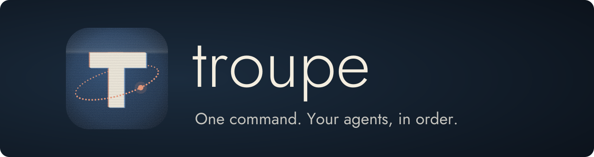
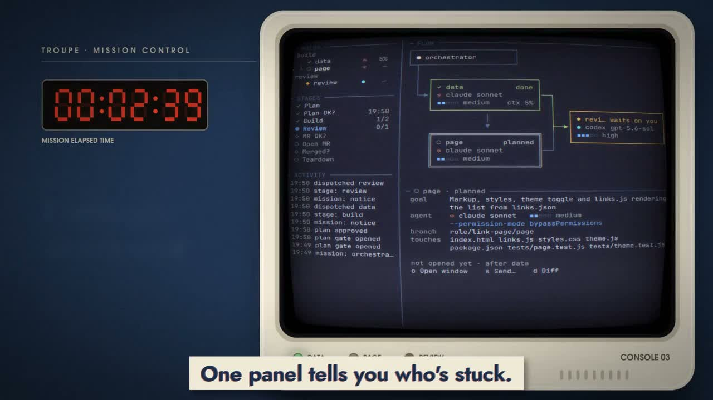
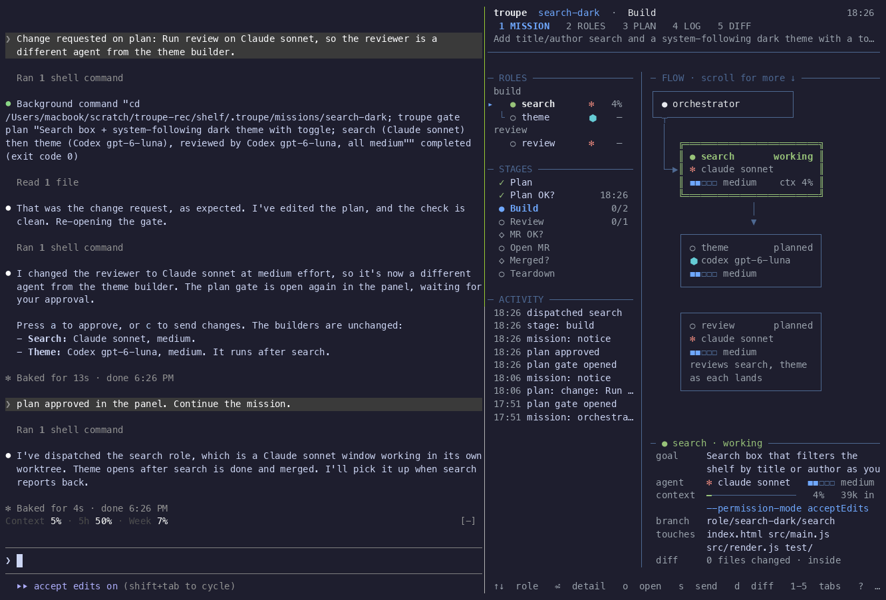
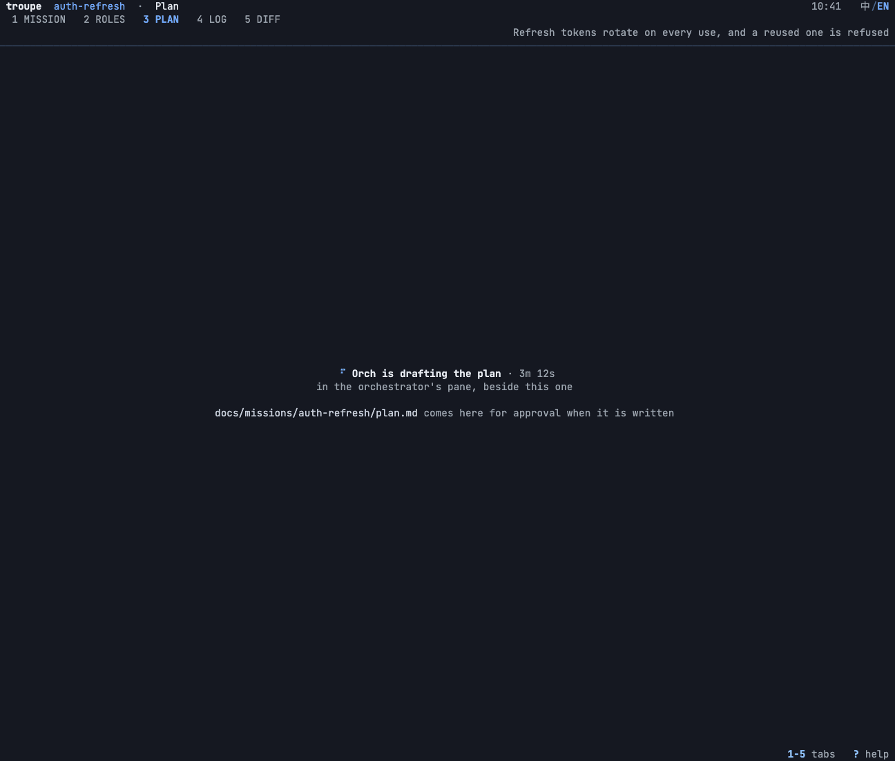
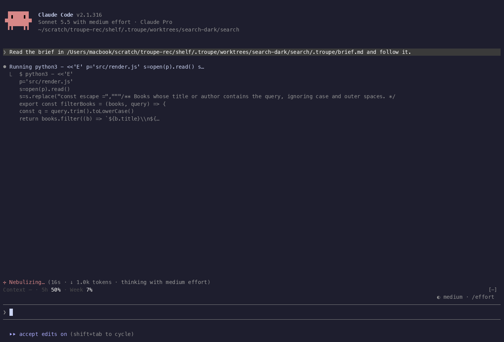
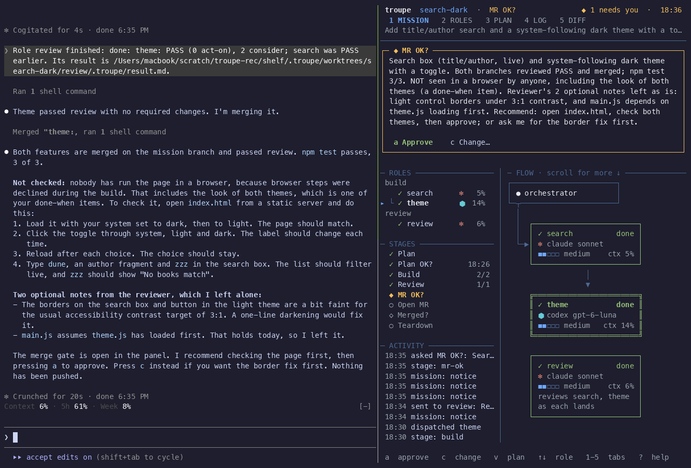

<p align="center">
  
</p>

<p align="center">
  Put Claude Code and Codex on the same team.<br>
  See every agent. Step in anytime.
</p>

<p align="center">
  <a href="README.md"></a>
  <a href="README.zh-CN.md"></a>
</p>

<p align="center">
  <a href="#demo"></a>
  <a href="#quick-start"></a>
  <a href="docs/guide.md"></a>
</p>

<p align="center">
  <a href="LICENSE"></a>
  <a href="docs/guide.md#agents"></a>
  
</p>

## Demo

A task from plan to review and cleanup, in 68 seconds.

<p align="center">
  <a href="https://github.com/hitianqi/troupe/releases/download/troupe-video-v2/troupe-demo-v2-en-web.mp4">
    
  </a>
  <br>
  <a href="https://github.com/hitianqi/troupe/releases/download/troupe-video-v2/troupe-demo-v2-en-web.mp4"><b>▶ English demo · 1:08</b></a>
  · <a href="https://github.com/hitianqi/troupe/releases/download/troupe-video-v2/troupe-demo-v2-zh-web.mp4">中文版</a>
  · <a href="https://github.com/hitianqi/troupe/releases/tag/troupe-video-v2">1080p downloads</a>
</p>

## Why troupe

- **See the team, and step in.** Every agent is a real Claude Code or Codex session. One panel shows who is working and who needs you. Jump into any agent's terminal to read along or answer it.
- **Agree on the work before it starts.** Review the plan, change the split, and approve it. Each role gets its own git worktree and branch; planned file overlaps need an explicit order.
- **Build and review with different agents.** Mix Claude Code and Codex, models and effort per role. The default workflow reviews each branch, asks before opening the pull request, and waits for your merge confirmation before cleanup.

<p align="center">
  
</p>

## Quick start

You need **macOS, Linux or WSL2**, **tmux**, **Node.js 20+**, **git**, and **Claude Code and/or Codex**, installed and signed in.

Install from source for now; the npm package is not published yet:

```sh
git clone https://github.com/hitianqi/troupe.git
cd troupe
npm ci
npm run build
npm link
troupe setup
```

`troupe setup` installs the workflow skill for the agents it finds.

Then open Claude Code or Codex **inside tmux, in the repository you want to change**, and ask:

```text
Run a troupe mission: add a search box that filters the list as you type,
and a dark theme that follows the system setting.
```

The agent writes the plan and opens the panel beside it. Read the plan, press **`a`** to approve or **`c`** to request changes, and the team starts after approval.

You can also run `troupe up -m <mission>` in your target repository to start the orchestrator and panel together.

## From one task to a finished change

1. **Plan together.** The orchestrator reads your code and proposes the work, roles and completion criteria. You can ask for changes before approving.
2. **Watch the team work.** Independent roles run in parallel; dependent roles wait their turn. Each has a terminal and worktree of its own. The panel shows when someone needs you.
3. **Review each branch.** A reviewer checks the work as it lands. Findings go back to the same agent for a fix round before the orchestrator merges into the mission branch.
4. **Approve the handoff.** You approve opening the pull request, merge it yourself, and confirm. The workflow then closes its terminals and removes its temporary worktrees.

<details>
<summary><b>See the plan approval, agent terminals and final handoff</b></summary>

**Change the plan, or approve it.**



**Claude Code, Codex and a reviewer, each in a real terminal.**



**You approve the pull request and confirm the merge before cleanup.**



</details>

## Make it yours

The workflow lives in a [skill](skills/troupe-mission/SKILL.md): when to review, when to merge and which questions to ask you. Change or replace it to fit how you work. The CLI checks plan approval, role dependencies, declared file overlaps and agent permissions.

Multiple missions can run in the same repository or across repositories. Each gets its own mission branch and worktree; your original checkout stays on its branch.

- [User guide](docs/guide.md) — plan format, commands, panel controls, adapters and known limits.
- [Roadmap](ROADMAP.md) — product direction and what's next.
- [Contributing](CONTRIBUTING.md) — development setup, checks and adding an agent.
- [Issues](https://github.com/hitianqi/troupe/issues) — bugs, questions and feature requests.

## Acknowledgements

<a href="https://github.com/Prover-Technology"></a>

troupe started as an internal tool at [Prover](https://github.com/Prover-Technology) and is open-sourced with their support. See [NOTICE](NOTICE).

<br clear="left">

MIT licensed. Built with TypeScript, tmux and git, with no runtime npm dependencies.
