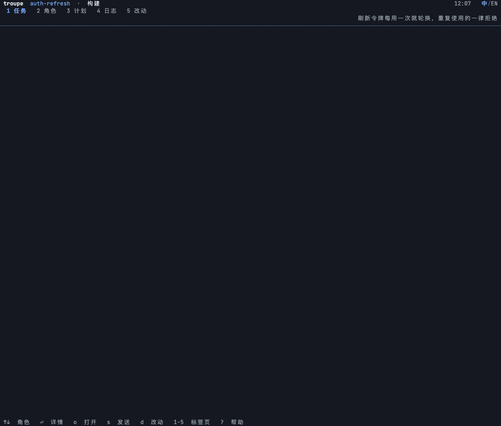
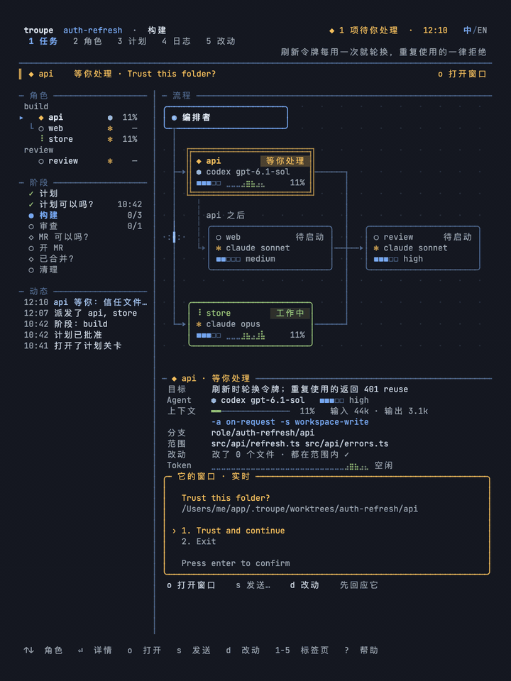
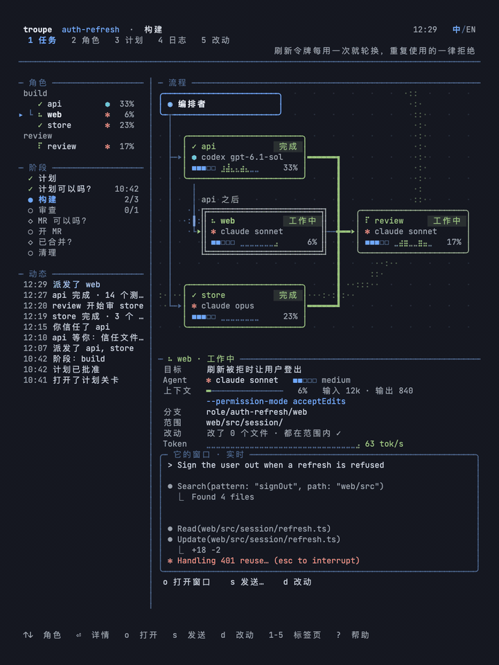
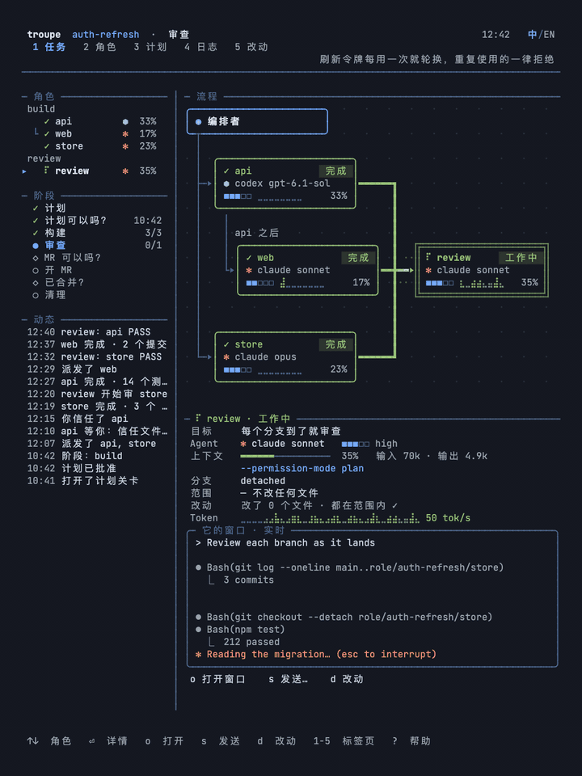

<p align="center">
  
</p>

<p align="center">
  让 Claude Code 和 Codex 组队干活。<br>
  一屏看全队，随时接手。
</p>

<p align="center">
  <a href="README.md"></a>
  <a href="README.zh-CN.md"></a>
</p>

<p align="center">
  <a href="#演示"></a>
  <a href="#快速开始"></a>
  <a href="docs/guide.zh-CN.md"></a>
</p>

<p align="center">
  <a href="LICENSE"></a>
  <a href="docs/guide.zh-CN.md#agents"></a>
  
</p>

## 演示

68 秒，看一个任务从计划、分工、审查，一直做到收尾。

<p align="center">
  <a href="https://media.tianqiz.me/troupe/film-zh.mp4">
    
  </a>
  <br>
  <a href="https://media.tianqiz.me/troupe/film-zh.mp4"><b>▶ 中文演示 · 1:08</b></a>
  · <a href="https://media.tianqiz.me/troupe/film-en.mp4">English</a>
  · <a href="https://github.com/hitianqi/troupe/releases/tag/troupe-video-v2">下载 1080p 版</a>
</p>

## 为什么用 troupe

- **看得见，也插得上话。** 每个 agent 都是真实的 Claude Code 或 Codex 会话。一个面板看谁在工作、谁在等你；随时跳进任何一个终端，看它干活，或直接回答它。
- **先同意怎么做，再开工。** 读计划、改分工、批准。每个角色都有自己的 git worktree 和分支；计划里会修改同一批文件的角色，必须排出先后。
- **让不同的 agent 构建和审查。** 每个角色可以选 Claude Code 或 Codex，以及自己的模型和 effort。默认工作流逐个审查分支，开 PR 前问你，等你确认合并后再清理现场。

<p align="center">
  
</p>

## 快速开始

需要 **macOS、Linux 或 WSL2**，以及 **tmux**、**Node.js 20+**、**git** 和已经安装并登录的 **Claude Code 和／或 Codex**。

安装：

```sh
npm install -g troupe-cli
troupe setup
```

想用自己构建的版本，见[参与贡献](CONTRIBUTING.md)。

`troupe setup` 会为找到的 agent 安装工作流 skill。

然后**在 tmux 里，进入你要修改的仓库**，打开 Claude Code 或 Codex，告诉它：

```text
用 troupe 跑一个 mission：加一个输入时实时过滤列表的搜索框，
再加一个跟随系统设置的暗色主题。
```

它会写好计划，在旁边打开面板。读计划，按 **`a`** 批准，或按 **`c`** 提修改；批准后，队伍才会开工。

也可以在目标仓库里运行 `troupe up -m <mission>`，一起启动编排者和面板。

## 一个任务怎么做完

1. **一起定计划。** 编排者读你的代码，提出分工、角色和完成标准。你可以先提修改，再批准。
2. **看队伍开工。** 互不依赖的角色并行，其余的等前置工作完成。每个角色都有自己的终端和 worktree，面板会告诉你谁需要你。
3. **逐个审查分支。** 审查者检查每个做完的分支，意见发回同一个 agent 修一轮，再由编排者合进 mission 分支。
4. **批准交付。** 你批准开 PR，自己合并，再确认。工作流随后关闭它开的终端，移除临时 worktree。

<details>
<summary><b>一步一步看它跑起来</b></summary>
<br>

<table>
<tr>
<td width="50%" valign="top"><br><b>1. 批准计划。</b> 编排者起草计划，你批准后，各个角色随即派发。</td>
<td width="50%" valign="top"><br><b>2. 看工作流动。</b> 每个角色在自己的窗口里干活；做完的分支一路亮到审查。</td>
</tr>
<tr>
<td width="50%" valign="top"><br><b>3. 需要你时再插手。</b> agent 等你时，面板会告诉你，并显示它的窗口。</td>
<td width="50%" valign="top"><br><b>4. 再看细一点。</b> 五个页面：全队、每个角色、计划、日志和改动。</td>
</tr>
<tr>
<td width="50%" valign="top"><br><b>5. 批准 PR。</b> 审查通过所有分支；你点头之后才开 PR。</td>
<td></td>
</tr>
</table>

</details>

## 按你的方式来

何时审查、何时合并、哪些事情要问你，都写在一个 [skill](skills/troupe-mission/SKILL.md) 里。你可以修改或替换它，换成自己的工作方式。CLI 检查计划批准、角色依赖、声明的文件重叠和 agent 权限。

可以在同一个仓库或不同仓库里同时跑多个 mission。每个 mission 都有自己的分支和 worktree，你原来的 checkout 始终停在原分支上。

- [使用指南](docs/guide.zh-CN.md)：计划格式、命令、面板操作、适配器和已知限制。
- [路线图](ROADMAP.md)：产品方向和下一步。
- [参与贡献](CONTRIBUTING.md)：开发环境、检查和新增 agent。
- [Issues](https://github.com/hitianqi/troupe/issues)：报 bug、提问或提需求。

## 致谢

<a href="https://github.com/Prover-Technology"></a>

troupe 最初是 [Prover](https://github.com/Prover-Technology) 的内部工具，在 Prover 的支持下开源。详见 [NOTICE](NOTICE)。

<br clear="left">

MIT 开源。用 TypeScript、tmux 和 git 构建，没有运行时 npm 依赖。
